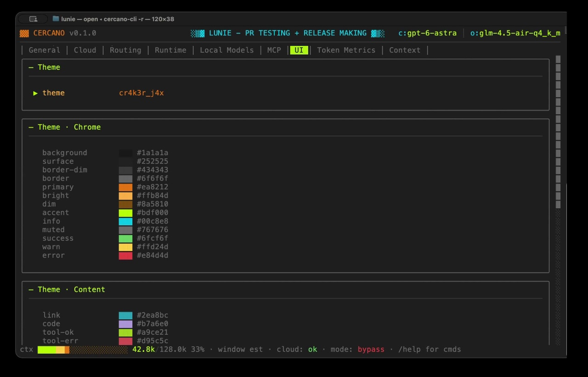

Cercano provides the runtime, terminal client, routing, tools, and context management for agent work. Start with the user guides below. Feature specifications elsewhere in the repository may include proposed behavior.

## Terminal and model setup

- [Terminal user interface](tui/)
- [Models and providers](models/)
- [First run](../getting-started/first-run/)

<figure><figcaption>Actual terminal UI image reused from the Cercano website.</figcaption></figure>

## Sessions, context, and configuration

Use the [agent command guide](https://github.com/cercano-ai/Cercano/blob/main/docs/agent/README.md), [independent task guide](https://github.com/cercano-ai/Cercano/blob/main/docs/agent/independent-tasks.md), and [context management guide](https://github.com/cercano-ai/Cercano/blob/main/docs/agent/features/context-management.md). [Configuration reference](../reference/) links to the current source of truth.

## IDE integrations

The [ACP guide](https://github.com/cercano-ai/Cercano/blob/main/docs/acp.md) is the initial source for compatible editor integrations. The repository also contains older IDE plans; installation and feature parity need an editor-specific documentation pass before migration.

## Persistent agents

The [hosted collaboration brief](https://github.com/cercano-ai/Cercloud/blob/main/product/hosted-collaboration.md) describes the intended always-on experience. A verified hosted-agent onboarding guide, lifecycle contract, and deployment availability remain gaps. Persistent sessions and independent tasks do not by themselves establish a hosted always-on service.

## Skills, agents, plugins, and workflows

[Extend the platform](../extend/) for current guides and the distinction between built-in, personal, repository, and enterprise skills.

