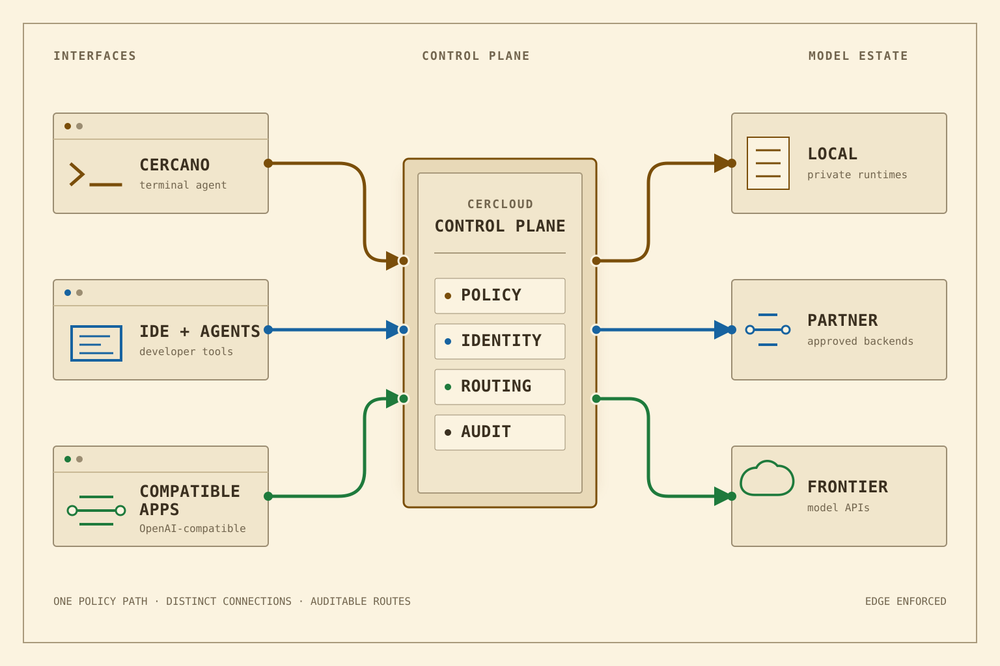

Cercano is the agent runtime and developer experience. The terminal client is one interface to the host that runs the work. The runtime also has headless and integration surfaces; the availability of each interface should be checked in its implementation guide.

Cercloud is the organizational platform and control plane. Its product scope includes identity, policies, approved models, routing, cost governance, auditability, shared context, workflows, skills, plugins, and specialized capabilities. That scope is broader than the enterprise pilot implemented today.

## Choose your setup

- **Personal use:** [install Cercano](install/) and configure a cloud provider or local model.
- **An organization account:** accept the invitation your administrator shares, then [connect the running host](connect/).
- **Administration:** review the [Cercloud guide](../cercloud/) and the service’s implementation status before provisioning a pilot.

## Runtime and control plane

In the current managed implementation, administrators publish immutable signed policy revisions. The Cercano host verifies the bundle and authorizes each physical inference request. Cercloud need not sit in the inference data path.

<figure><figcaption>Existing Cercloud platform illustration. It describes the platform architecture and intended scope; it is not a feature availability matrix.</figcaption></figure>

## Availability in this draft

| Surface | Documentation scope |
| --- | --- |
| Terminal client and host | Packaged install and current user guides. |
| Managed policy and shared skills | Implemented pilot integration; live acceptance remains separate. |
| IDE integrations | Separate integration guides; do not assume TUI parity. |
| Persistent hosted agents | Product direction; deployment and user onboarding not established here. |
| Budgets, quotas, SAML, SCIM, LDAP, central proxy | Proposed scope; no operating instructions claimed. |

Sources: [Cercano README](https://github.com/cercano-ai/Cercano/blob/main/README.md), [Cercloud product family](https://github.com/cercano-ai/Cercloud/blob/main/README.md), [enterprise implementation status](https://github.com/cercano-ai/cercano-enterprise/blob/main/docs/implementation-status.md).

